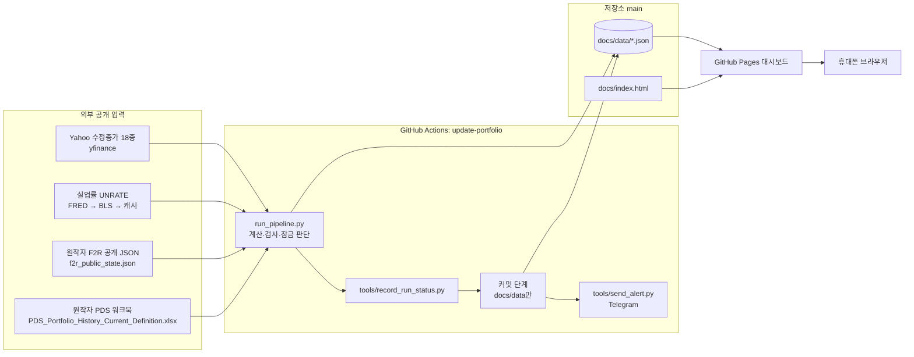
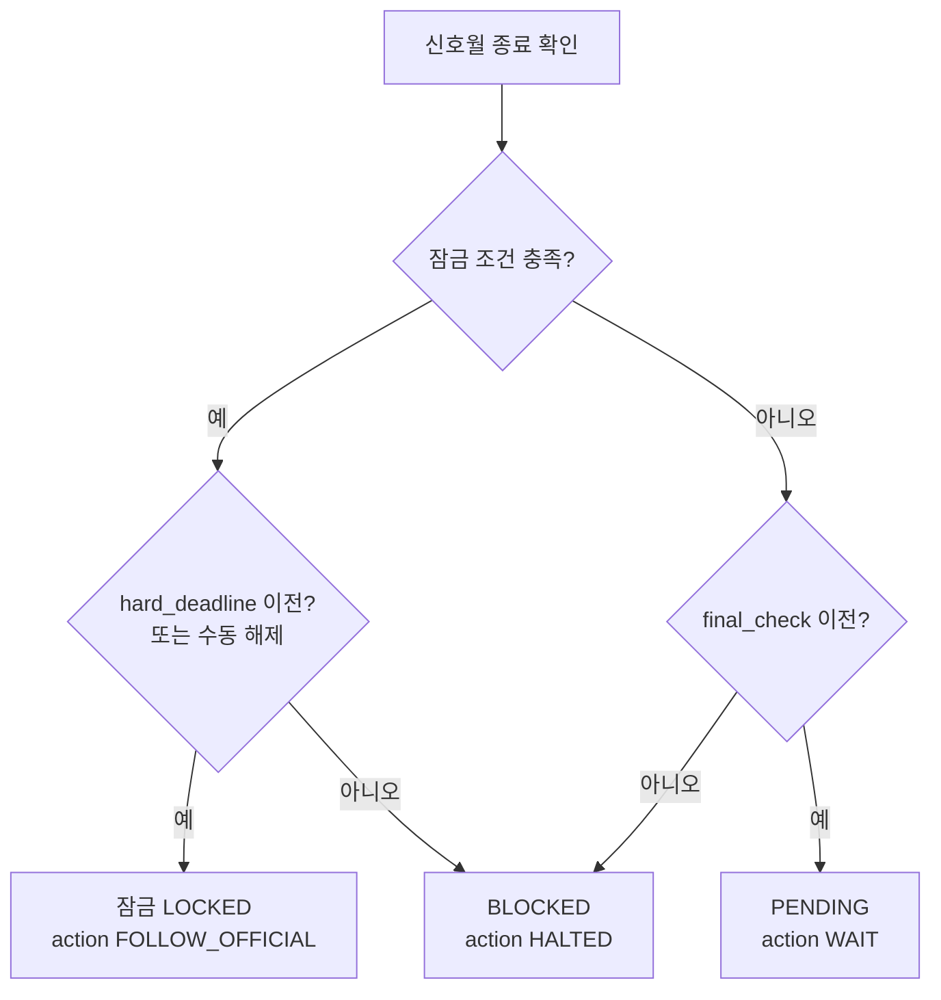

# ① PDS-Lite 시스템 분석·설계서

- 기준: main `e6b1822`(PR #4 병합, 2026-11-27). 운영 데이터(`docs/data`)는 `4c747f3`과 같다.
- 근거 표기([코드]·[데이터]·[원작자]·[추정]·[미확인])와 공통 용어는 [handbook/README.md](README.md)를 따른다.
- 이 문서는 "지금 main에 있는 것"을 설명한다. 문서·화면과 구현이 다른 곳은 [③ 7장](03-change-history-and-policy.md#7-문서화면과-실제-구현의-차이)에 모았다.

---

## 1. 목적과 범위

### 1.1 목적
원작자(SlackQuant)의 PDS 전략(Core + Adaptive)의 **월말 목표 비중**을 공개 자료만으로 재구성해 매달 하나의 공식 목표로 확정하고, 휴대폰 화면으로 보여 주는 개인용 시스템이다. 서버 없이 GitHub Actions(계산)와 GitHub Pages(화면)만 쓴다. [코드: `run_pipeline.py` 모듈 설명, `README.md`]

### 1.2 하는 일과 하지 않는 일

| 하는 일 | 하지 않는 일 |
|---|---|
| 공개 데이터 수집(가격·실업률·원작자 F2R·원작자 워크북) | **증권사 주문, 계좌 연동.** 코드 어디에도 주문·계좌 API가 없다 [코드] |
| 목표 비중 계산(Core, Adaptive, 자산군, IRP 대체 ETF) | 계좌 금액 저장. 화면의 금액 입력은 그 브라우저의 localStorage에만 남는다 [코드: `docs/index.html`] |
| 원작자 공개 Core와 대조 | 원작자 Adaptive(PPO 앙상블) 계산. 모델이 비공개라 재현할 수 없다 [원작자] |
| 조건이 갖춰진 달만 월 1회 잠금(공식 목표 확정) | 조건이 안 갖춰진 달을 추정값으로 메우기 |
| 화면 표시, 상태가 바뀔 때 Telegram 알림 | 투자 권유. 화면·데이터에 "Not investment advice"를 명시한다 [코드] |

**목표 비중 산출과 실제 주문 실행은 별개 영역이다.** 이 시스템의 결과는 "이번 달 목표 비중"까지이며, 주문 여부·시점·수량은 사람이 증권사에서 직접 정한다. 2026-11-26 PR #1 병합 승인도 "목표 비중 산출과 운영 안전장치 적용"에 한정되며 주문 자동화는 승인 범위가 아니다(③ 6장).

### 1.3 설계 원칙
1. **불확실하면 결정하지 않는다.** 데이터가 불완전하거나 판단 근거(원작자 공식값)가 확인되지 않으면 새 목표를 확정하지 않고 직전 공식 목표를 유지한다(잠금 대기·보류, fail-closed).
2. **한 번 확정한 목표는 바꾸지 않는다.** 잠긴 달은 다시 계산하지 않는다(추가 전용 잠금).
3. **원작자와 같은 Core만 확정한다.** 원작자가 공개한 그 달 Core와 1e-6 이내로 같을 때만 잠근다.
4. **원작자 Adaptive는 잠글 때 이미 공개된 공식값만 쓴다.** 나중에 공개·수정된 값은 참고 기록에만 남긴다.
5. **사람이 멈출 수 있어야 한다.** 운영자 중지(`PDS_HALT`)는 코드 변경 없이 모든 신규 잠금을 막는다.

---

## 2. 전체 아키텍처

### 2.1 구성도

글로 풀면: 예약 실행 → `run_pipeline.py`가 공개 입력 4종을 받아 계산·검사 → 모든 검사를 통과하면 `docs/data`의 JSON을 쓴다 → `record_run_status.py`가 실행 기록을 남긴다 → 커밋 단계가 `docs/data`만 main에 커밋한다 → 상태가 바뀌었으면 Telegram 알림 → Pages가 `docs/index.html`과 JSON을 배포하고, 휴대폰 화면이 JSON을 읽어 그린다. [코드]

### 2.2 디렉터리 구조 [코드]

| 경로 | 줄 수 | 역할 |
|---|---|---|
| `run_pipeline.py` | 1,495 | 엔진 전체: 수집, 슬리브·Core·Adaptive 계산, 잠금 판단, 안전장치, 화면 JSON |
| `docs/index.html` | 332 | 대시보드(정적 HTML, Tailwind·Chart.js CDN) |
| `docs/data/` | – | 운영 데이터 7개(4.3절). 봇만 커밋 |
| `tools/record_run_status.py` | 126 | `run_status.json` 작성, 단계 출력(action·notify·halt) |
| `tools/notify_message.py` | 90 | 알림 문구 |
| `tools/send_alert.py` | 102 | Telegram 전송·전달 확인·실패 기록 |
| `tools/release_auth.py` | 80 | 수동 해제 요청자·승인 기록 수집(GitHub API) |
| `tools/rollback_check.py` | 133 | 롤백 사전 점검(읽기 전용) |
| `tools/ops_audit.py` | 177 | 권한·설정 점검(읽기 전용) |
| `.github/workflows/update.yml` | 230 | 운영 실행(유일하게 쓰기 권한) |
| `.github/workflows/tests.yml` | 180 | 브랜치·PR CI(읽기 전용) |
| `.github/workflows/rollback-check.yml` | 33 | 롤백 사전 점검 수동 실행 |
| `.github/workflows/ops-audit.yml` | 28 | 권한 점검(매월 11일·수동) |
| `tests/` | 2,009 | `test_reference_only.py`(59개 함수), `test_equivalence.py`(4개), `_harness.py`, `conftest.py` |
| `requirements.txt` | 4 | pandas≥2.2, numpy≥1.26, openpyxl≥3.1, yfinance≥0.2.50 (상한 없음) |
| `handbook/` | – | 이 문서들 |

### 2.3 외부 입력 [코드]

| 입력 | 코드 위치 | 용도 | 실패할 때 |
|---|---|---|---|
| Yahoo 수정종가(배당·분할 조정), 18종, 2015-01-01부터 | `fetch_prices()` | 모든 신호 | 3회 재시도 후 실행 실패(아무것도 안 씀). 오늘 봉에 빠진 종목이 있으면 그 행을 버림 |
| 실업률 UNRATE | `fetch_unrate()`: FRED CSV → BLS API(`LNS14000000`) → `docs/data/unrate_cache.csv` | LAA | 캐시까지 실패하면 실행 실패. 캐시를 쓰면 `UNRATE_FROM_CACHE` 경고, 수동 해제 거부 |
| 원작자 F2R 공개 JSON (`F2R_STATE_URL`) | `fetch_f2r_state()`, `f2r_book()` | F2R Top-4 | `F2R_UNAVAILABLE` 경고. 그 달 F2R이 공식이 아니므로 잠그지 않음 |
| 원작자 PDS 워크북 (`REF_WORKBOOK_URL`) | `fetch_reference_workbook()` | 원작자 Core 대조, 원작자 Adaptive 값 | 원작자 Core가 없으므로 실시간 달은 잠그지 않음. Adaptive는 RB = 1 |

### 2.4 실행 환경 [코드]
GitHub Actions `ubuntu-latest`, Python 3.12. `requirements.txt`에 상한이 없어 실행할 때마다 최신 패키지가 설치된다(9.4절 위험).

---

## 3. 투자전략과 계산 로직

이 장의 수식은 원작자 규칙을 옮긴 것이고, 구현은 [코드], 원작자와 같다는 근거는 실데이터 대조 [데이터]다(3.9절). 원작자 규칙의 출처 파일은 `run_pipeline.py` 맨 위 설명에 적혀 있다(`adaa-decision-diversification` 저장소의 R·Python 코드).

### 3.1 유니버스와 자산군 [코드: `UNIVERSE`, `ASSET_CLASS`]

| 자산군 | ETF |
|---|---|
| 주식(Equity) | QQQ, SPY, IWM, EEM, EFA, EWY, VGK |
| 채권(Fixed Income) | AGG, TIP, IEF, TLT, LQD, HYG, SHY |
| 실물/기타(Real Assets / Other) | DBC, VNQ, GLD |
| 현금(Cash) | BIL |

### 3.2 월말 가격과 기호
- `month_end_frame()`: 각 달의 **마지막으로 있는 종가**. 진행 중인 달이면 최신 종가(= Preview 기준).
- 아래에서 P(t)는 신호월 t의 월말 종가, P(t−k)는 k개월 전 월말 종가.
- 평균 비율 점수 `_ratio_avg(lags)` = 평균ₖ[P(t)/P(t−k)].
- SMA13 비율 `_sma_ratio` = P(t) / 평균(P(t−12)…P(t)).
- 순위는 R의 `rank(ties="average")`와 같다(오름차순, 동점은 평균 순위). 그래서 동점이면 선택 개수가 달라질 수 있다.

### 3.3 ADAA 5개 슬리브 [코드]

| 슬리브(비중) | 함수 | 규칙 |
|---|---|---|
| HAA (25%) | `sleeve_haa` | 카나리아 = TIP의 1·3·6·12개월 수익 합. **> 0(공격)**: 위험 11종(SPY QQQ IWM EFA EEM VNQ DBC IEF TLT EWY GLD)을 평균비율(1,3,6,12) 순위로 Top-6 × 1/6. **≤ 0(방어)**: IEF·BIL 중 점수가 높은 쪽 100% |
| BAA 공격형 (15%) | `sleeve_baa` | 카나리아 SPY·EEM·EFA·AGG의 13612W 모멘텀(12·r1 + 4·r3 + 2·r6 + r12)이 **모두 ≥ 0(공격)**: QQQ·EEM·EFA·AGG 중 SMA13 비율 1위 100%. **아니면(방어)**: TIP·DBC·IEF·TLT·LQD·AGG·BIL 중 SMA13 비율 Top-3 × 1/3, 그중 SMA13 비율이 BIL 이하인 자산은 BIL로 대체 |
| ADM (17.5%) | `sleeve_adm` | 위험 12종(SPY QQQ VGK EWY EEM VNQ DBC GLD TLT HYG LQD TIP)을 평균비율(1,3,6) 순위로 Top-6, **점수 ≥ 1인 것만** 1/6씩(절대 모멘텀). 나머지는 SHY와 BIL 중 SMA13 비율이 높은 쪽 |
| FAA (17.5%), `legacy_v011` | `sleeve_faa` | 같은 12종. 모멘텀 M = 평균비율(3,6,12), 변동성 V = 최근 6개 월수익의 표준편차, 상관 C = 최근 6개 월수익과 12종 동일가중 평균(자기 포함)의 상관. 종합 = 순위(M 내림차순) + 0.5·순위(V) + 0.5·순위(C), 종합 순위 ≤ 6 선택(동점이면 5~7개), 모멘텀 ≥ 1인 것만 1/선택수. 나머지는 ADM과 같은 SHY/BIL |
| LAA (25%) | `sleeve_laa` | 고정: SPY 17.5%, IEF 25%, GLD 25%, EEM 5%, EWY 2.5%. 전환 25%: **SPY/SMA11 > 1 또는 UNRATE(t−1)/SMA13(UNRATE) < 1이면 QQQ, 아니면 SHY**. 실업률은 신호월 직전 달 값을 쓰고, 미발표 달은 직전 값으로 채운다(`unrate_carry_calendar`, `UNRATE_CARRIED` 표시) |

- 혼합: `SLEEVE_MIX = {HAA 0.25, BAA 0.15, ADM 0.175, FAA 0.175, LAA 0.25}`, `adaa_weights()`. 슬리브 하나라도 자료가 부족하면 그 달 계산은 실패한다.
- FAA 변형: `FAA_VARIANT`(환경변수, 기본 `legacy_v011`). 원작자 논문 수정판(`canonical_v016`)은 실데이터에서 77/116개월만 원작자 Core와 맞았고 legacy는 116/116이었다 [데이터: `portfolio_latest.json` `validation.faa_variant_match`]. 즉 원작자 운영본은 legacy FAA를 쓴다.
- 모든 ADAA 비중은 1/2400 격자 위에 있다(테스트 `test_engine_invariants_on_synthetic`).

### 3.4 F2R 10% [코드: `f2r_book`, `f2r_weights`, `f2r_proxy`]
- 원작자 F2R 공개 JSON에서 그 달 Top-4를 읽어 각 25%. 출처 표시는 다음 셋이다.
  - `F2R_PUBLISHED`: `historical_targets.full_history`의 순위, 또는 `live_state.official`의 보유 비중
  - `F2R_PREVIEW`: `live_state.preview`. 월중 추정
  - `F2R_PROXY_MOMENTUM`: JSON에 그 달이 없을 때의 **자체 대체**. F2R 11종을 평균비율(1,3,6,12)로 정렬해 Top-4, 동점은 원작자 고정 순서
- 원작자 F2R 모델(Ridge·ElasticNet·XGBoost 순위 앙상블 + Chronos-2 20%)은 특징량이 비공개라 계산하지 않는다 [원작자].
- **잠금에는 `F2R_PUBLISHED`만 쓴다**(5.2절).

### 3.5 Core [코드: `core_weights`]
**Core = 0.90 × ADAA + 0.10 × F2R** (`CORE_MIX`). 원작자 워크북 253개월에서 이 식이 최대 오차 5.6e-17로 맞았다 [원작자 워크북 대조, 역추적 문서 기준].

계산 예(2026-10 신호월, 현재 Official) [데이터]:
- F2R Top-4: QQQ, SPY, EWY, DBC.
- SPY = 0.9 × (HAA 0.25×1/6 + ADM 0.175×1/6 + FAA 0.175×1/6 + LAA 0.25×0.175) + 0.1 × 0.25 = 0.129375 + 0.025 = **15.4375%**
- 전체: BIL 16.875, DBC 16.0, SPY 15.4375, QQQ 8.125, EWY 6.8125, VNQ 6.375, IEF 5.625, GLD 5.625, IWM 3.75, EFA 3.75, VGK·TIP·TLT·LQD 각 2.625, EEM 1.125(%).
- 자산군: 주식 41.6%, 채권 13.5%, 실물 28.0%, 현금 16.9%.

### 3.6 Adaptive와 RB [코드: `apply_risk_budget`, `adaptive_rule`, `reference_row_problems`]

**Adaptive = RB × Core + (1 − RB) × BIL**

| 상태 | RB | 뜻 |
|---|---|---|
| NORMAL | **1.0 (100%)** | **Adaptive = Core 그대로.** 방어가 아니다. BIL이 보인다면 Core 규칙(HAA·BAA·ADM·FAA의 방어 분기) 자체가 BIL을 고른 것이다 |
| DEFENSIVE | 0.55 이상 1 미만 | Core를 RB만큼 줄이고 나머지를 BIL로. 0.55는 원작자 공개값의 최저치(`ADAPTIVE_FLOOR`) |

원작자의 Adaptive는 5-시드 PPO 앙상블과 변동성 확인을 결합한 비공개 규칙이다 [원작자]. PDS-Lite는 이를 계산하지 않고, 운영 모드 `reference_only`(기본, `ADAPTIVE_MODE`)에서 다음 표로 RB를 정한다 [코드: `adaptive_rule`].

| 대상 달 | 조건 | 결과 | `sources.adaptive` |
|---|---|---|---|
| 실시간 달(LIVE) | 잠그는 실행이 받은 워크북에 그 달 원작자 행이 있고 상태가 OFFICIAL·FORWARD_MONITOR·HISTORY이며 검사 통과 | 원작자 상태·RB | `REFERENCE_<상태>_AT_LOCK` |
| 실시간 달 | 원작자 행 없음 | NORMAL, RB 1.0 | `CORE_DEFAULT_REFERENCE_NOT_PUBLISHED` |
| 실시간 달 | 원작자 행이 검사 실패 | NORMAL, RB 1.0 | `CORE_DEFAULT_REFERENCE_REJECTED` |
| 백필 달 | 항상 | NORMAL, RB 1.0 | `CORE_DEFAULT_BACKFILL` |
| Preview | 항상(원작자 PREVIEW 값은 참고로만 기록) | NORMAL, RB 1.0 | `CORE_DEFAULT_PREVIEW` |

- 원작자 행 검사(`reference_row_problems`): 상태가 NORMAL/DEFENSIVE, NORMAL이면 RB = 1, DEFENSIVE면 0.55 ≤ RB < 1, 상태 표시가 실행 가능한 것(PREVIEW 제외). 실패하면 RB = 1.
- 그 밖의 모드: `core_only`(운영 가능, 항상 RB = 1), `reference_then_proxy`·`proxy`(**진단 전용**, 운영 파일·잠금을 쓰지 않음, `docs/data/diagnostic/`에만 기록).
- 자체 대체 규칙 `adaptive_proxy()`는 PDS-Lite가 만든 규칙이다(SPY 12개월 누적수익이 BIL 이하 **그리고** 0.10/σ(63일 Core) < 1이면 DEFENSIVE, RB = max(0.55, 0.10/σ)). 원작자와 다르다. 지금은 모든 결정에 진단값(`sources.proxy`)으로만 기록되고 비중에 쓰이지 않는다. 다만 현재 잠금 116개월 중 49개월(2017-03~2021-03)은 v1.0 시절 이 규칙으로 잠겼다(6.2절).
- **원작자 공식 Adaptive 공개는 월말 1~8일 뒤였다** [원작자, 역추적 문서: 2026-09 10/02, 2026-10 11/08]. 잠금 시점(Core·F2R 공개 직후)에 아직 없을 가능성이 높아, 앞으로의 실시간 달은 대부분 RB = 1로 잠길 것으로 예상된다 [추정].

### 3.7 IRP 변환 [코드: `IRP_MAP`, `to_irp`]
1. 미국 ETF마다 국내 상장 ETF(종목코드·이름·위험/안전 구분·대체 메모)를 지정한다. 같은 국내 ETF로 가는 비중은 합친다(예: SPY + IWM → 360750 TIGER 미국S&P500, DBC + GLD → 411060 ACE KRX금현물).
2. 위험자산 합계가 **68%**(퇴직연금 위험자산 한도 70% − 가격변동 버퍼 2%p, `IRP_RISK_CAP`, `IRP_CAP_BUFFER`)를 넘으면 위험 종목을 같은 비율로 줄이고, 줄인 만큼 **329750 TIGER 미국달러단기채권액티브**(`IRP_OVERFLOW`)로 옮긴다.
3. 합계가 1이 아니면 실행 실패.

현재 Official(2026-10) Adaptive 기준: 위험 69.6% → 68.0%, 안전자산으로 1.625%p 이동 [데이터].

대체 매핑과 위험/안전 구분은 PDS-Lite가 정했다. 원작자 전략에는 IRP가 없다. 각 ETF의 규정상 위험·안전 분류와 퇴직연금 매수 가능 여부는 이 문서에서 검증하지 않았다 [미확인]. 메모에 적힌 대체(IWM→S&P500, TIP→미국10년국채, DBC→금현물, EFA→MSCI선진국(미국 포함) 등) 때문에 IRP 수익은 원작자 Core와 달라진다.

### 3.8 회전율과 예상 비용 [코드: `_block`]
- 편도 회전율 = Σ|이번 Adaptive − 직전 Adaptive| / 2 (Official은 직전 잠금 달 대비, Preview는 현재 Official 대비).
- 예상 비용 = Σ|차이| × 10bp(`COST_PER_SIDE`) = 2 × 편도 회전율 × 0.001. 원작자 공식과 같은 형태다.
- **목표 대비 목표 기준이라 월중 가격 변동(drift), 스프레드, 환전, 세금은 빠져 있다.** 실제 비용보다 낮게 나온다.

### 3.9 원작자 대조 검증 [코드: `validate_against_reference`, `diagnose_faa_variants`]
- 매 실행마다 잠금된 모든 달의 Core를 원작자 워크북 Core(PREVIEW 제외)와 비교한다. 결과는 `validation`(일치 개월 수, 최대 오차, 최근 불일치 12개)에 남고, 화면 아래쪽에 표시된다.
- 현재: **116/116개월 일치, 최대 오차 3.9e-16** [데이터: 2026-11-26 11:50 UTC 운영 실행].
- FAA 세 변형의 일치율도 함께 기록한다: legacy 116/116, peer_rank 84/116, canonical 77/116 [데이터].

---

## 4. 데이터 흐름과 저장 구조

### 4.1 한 번의 실행 순서 [코드: `run_engine`, `main`]
1. 가격 수집 + 무결성 검사(4.2절). 실패하면 중단.
2. 실업률, F2R JSON, 원작자 워크북 수집.
3. 월말 프레임과 시계 판정(`split_clock`, 4.4절).
4. 기존 잠금·감사 기록·해제 기록을 읽는다.
5. 수동 해제 요청이 있으면 요청 검사를 먼저 한다(6.5절).
6. 운영자 중지면 처리할 달 목록을 비우고 HALTED로 표시한다(6.4절).
7. 아직 잠기지 않은 달마다 결정을 계산하고, 잠금·대기·보류·건너뜀을 판정한다(5장).
8. 잠금·감사·해제 기록이 추가 전용인지 검사한다(6.1절).
9. Preview, 경고 코드, 참고 원장, 원작자 대조, 화면 JSON을 만든다.
10. **여기까지 오류가 없을 때만** `main()`이 파일을 하나씩 쓴다(임시 파일에 쓴 뒤 교체). 운영자 중지면 아무 파일도 쓰지 않는다.
11. 이번 실행 결과를 `run_result.json`(커밋 안 함)에 쓴다.

예외: 실업률 수집이 성공하면 `unrate_cache.csv`는 2단계에서 바로 갱신된다(운영자 중지 때는 쓰지 않음). 그 뒤 실행이 실패하면 워크플로 커밋 단계가 이 변경을 되돌리므로 저장소에는 남지 않는다. 로컬에서 직접 돌릴 때는 남을 수 있다.

### 4.2 가격 무결성 검사 [코드: `check_price_integrity`]
최근 400거래일(`INTEGRITY_WINDOW`)에 대해 다음 중 하나라도 있으면 실행을 멈춘다.
- 열이 18종 유니버스와 다름 / 결측 / 0 이하 가격
- 하루 변동 ±25% 초과(`MAX_DAILY_MOVE`)
- 18종 모두 2거래일 연속 불변(`FROZEN_ALL_DAYS`, 피드 고착)
- 한 종목이 10거래일 연속 불변(`FROZEN_ONE_DAYS`, BIL 제외)
- 전체 행이 300개 미만

### 4.3 저장 파일 [코드, 데이터]

| 파일 | 쓰는 주체 | 언제 | 성격 | 현재 |
|---|---|---|---|---|
| `docs/data/official_history.json` | 파이프라인 | 성공한 운영 실행 | **추가 전용 잠금.** 공식 결정 | 116개월(2017-03~2026-10) |
| `docs/data/portfolio_latest.json` | 파이프라인 | 성공한 운영 실행 | 화면용 전체 결과(매번 새로 씀) | Official 2026-10 |
| `docs/data/reference_adaptive.json` | 파이프라인 | 성공한 운영 실행 | 추가 전용 참고 원장 | 68행(전부 seeded) |
| `docs/data/official_events.json` | 파이프라인 | 성공한 운영 실행 | 추가 전용 감사 기록 | 0건 |
| `docs/data/manual_releases.json` | 파이프라인 | 성공한 운영 실행 | 추가 전용 수동 해제 기록 | 0건 |
| `docs/data/unrate_cache.csv` | 파이프라인 | 실업률 수집 성공 시 | 실업률 캐시 | 2013-01~2026-10 |
| `docs/data/run_status.json` | `record_run_status.py`, `send_alert.py` | **매 실행**(성공·실패·중지) | 최근 실행 상태, 최근 60회 기록 | ok, FOLLOW_OFFICIAL |
| `run_result.json` | 파이프라인 | 성공 시 | 이번 실행 결과(워크플로 전달용) | 커밋 안 함, 아티팩트에만 |
| `release_auth.json` | `release_auth.py` | 수동 해제 요청 시 | 요청자·승인 정보 | 커밋 안 함 |
| `run.log` | 워크플로 | 매 실행 | 실행 로그 | 커밋 안 함 |
| `docs/data/diagnostic/` | 파이프라인 | 진단 모드·reference 모드 | 진단 출력 | git 제외 |

#### `official_history.json` 한 항목
`status`, `signal_month`, `holding_month`, `state`, `risk_budget`, `core{18종}`, `adaptive{18종}`, `sources`, `locked_at_utc`, `origin`, (수동 해제면) `manual_release`.
- `sources`: `f2r`(F2R 출처), `adaptive`(RB 출처), `adaptive_mode`, `unrate_carried`, `asof`(신호 컷오프 날짜), `reference_seen`(그때 본 원작자 행), `proxy`(자체 대체 규칙 진단값), `sleeves`(슬리브별 비중).
- `origin`: `LIVE`(예약 실행이 실시간으로 잠금), `BACKFILL_RECOMPUTED`(과거 재구성), `MANUAL_RELEASE`.
- 화면 분류 `record_class`는 저장하지 않고 화면 JSON을 만들 때 계산한다(`record_class()`): origin이 LIVE이고 컷오프 14일 이내(`LIVE_LOCK_MAX_DAYS`)에 잠겼으면 LIVE, 아니면 RECONSTRUCTED.

#### `portfolio_latest.json` 주요 키
| 키 | 내용 |
|---|---|
| `generated_at_kst`, `market_asof` | 생성 시각, 마지막 종가 날짜 |
| `official`, `preview` | 블록: `status`, `signal_month`, `holding_month`, `state`, `risk_budget`, `sources`, `turnover_one_way`, `est_cost`, `us[]`(종목별 core·adaptive·delta), `asset_class`, `irp{adaptive, core}` |
| `history[]` | 잠금 전체의 자산군·RB 추이, `adaptive_source`, `record_class` |
| `action` | `code`(FOLLOW_OFFICIAL / WAIT / HALTED), `month`, `in_force`, `reason`, `message` |
| `flags`, `flags_scoped` | 경고 코드 전체, 그리고 official·preview·run 범위별 분리(PR #2) |
| `validation` | 원작자 Core 대조, FAA 변형 진단, `new_official_locks` |
| `reference` | 원작자 Adaptive 참고값(공식 달·Preview·대기 달) |
| `unlocked_gaps`, `official_events`(최근 12), `notify`, `manual_release`, `config` | 운영 정보 |

#### `run_status.json`
`ok`, `action`, `operator_halt`, `notify`(이번 실행에서 알릴 사건), `notify_pending`(전달 실패로 미뤄진 알림), `finished_utc`, `event`(트리거), `run_url`, `log_tail`(마지막 40줄), `recent[]`(최근 60회: 시각, 성공 여부, action, 사유, 신규 잠금 수, `notified`, 실행 URL), 중지 때 `halt_report`, 알림을 시도했으면 `delivery`.

`recent[].notified`는 "알림 대상"을 적은 것이지 실제 전달 증거가 아니다. 전달 결과 `delivery`는 알림 단계가 커밋 **뒤에** 쓰므로, 저장소의 `run_status.json`에는 전달 실패(`failed`)일 때만 커밋되고(다음 실행이 파일을 다시 쓰면 사라짐) 성공(`sent`)·건너뜀 기록은 그 실행의 아티팩트와 단계 로그에만 남는다(7.5절).

### 4.4 시계: 신호월·보유월·Preview [코드: `split_clock`]
- 마지막 일봉이 그 달 NYSE 마지막 거래일이고 그 봉이 확정(다음 날이거나 21:30 UTC 이후)이면 그 달이 끝난 것으로 본다. 끝난 가장 최근 달이 "잠글 수 있는 마지막 신호월"이고, 진행 중인 달이 Preview 대상이다.
- NYSE 휴장일은 코드에 고정된 규칙(신정, MLK, 대통령의 날, 성금요일, 메모리얼, 준틴스, 독립기념일, 노동절, 추수감사절, 성탄절)으로 계산한다. 임시 휴장은 반영되지 않는다(9.4절).
- 보유월 = 신호월 + 1.

---

## 5. 공식 목표와 Preview

### 5.1 상태값
| 위치 | 값 | 뜻 |
|---|---|---|
| 블록 `status` | `OFFICIAL` | 잠긴 공식 목표 |
| | `PENDING` | 신호월은 끝났지만 잠금 조건 미충족, 10일 마감 전 |
| | `BLOCKED` | 10일 마감 뒤에도 미충족 또는 마감 뒤에야 충족 |
| | `PREVIEW` | 진행 중인 달의 월중 추정 |
| `action.code` | `FOLLOW_OFFICIAL` | 공식 목표 유효(새로 잠갔거나 잠글 달 없음) |
| | `WAIT` | 잠금 대기. 리밸런싱하지 말고 보유 유지 |
| | `HALTED` | 10일 마감 보류 **또는** 운영자 중지. `reason`으로 구분 |

### 5.2 잠금 조건 [코드: `official_hold_reason`]
실시간 달은 다음을 **모두** 만족해야 잠긴다.
1. 그 달 F2R 출처가 `F2R_PUBLISHED`(`OFFICIAL_REQUIRES_F2R_PUBLISHED=1`, 워크플로가 "1"로 고정).
2. 원작자 워크북에 그 달 Core 행(PREVIEW 아님)이 있고, 자체 Core와 모든 종목 차이가 1e-6 이하(`OFFICIAL_REQUIRES_AUTHOR_CORE=1`, 워크플로가 "1"로 고정).
3. 운영자 중지가 아님.
4. 마감 안에 충족(5.3절).

차이가 1e-6을 넘으면 `CORE_MISMATCH` 사건(월 1회 알림)과 함께 잠그지 않는다. 2026-09·10월은 원작자 F2R과 Core가 월말 2일 뒤 같은 날 공개됐다 [원작자, 검토서 기록].

### 5.3 월간 판정 흐름 [코드: `run_engine`, `lock_deadlines`]

보유월 D일 = 신호월 다음 달 D일(UTC). `final_check` = 10일 22:00 UTC, `hard_deadline` = 10일 23:59:59 UTC.

| 시점(UTC) | 조건 미충족 | 조건 충족 |
|---|---|---|
| 신호월 마지막 거래일 22:40 ~ 보유월 10일 22:00 전 | PENDING / WAIT, 첫날 `PENDING` 사건(알림 1회) | 잠금, `LOCKED` 사건(알림) |
| 10일 22:00 ~ 23:59:59 (10일 22:40 예약 실행이 마지막 확인) | BLOCKED / HALTED, `BLOCKED` 사건(알림 1회) | 잠금 |
| 11일 0시 이후 | BLOCKED 유지(사건은 한 번만) | **자동 잠금 없음.** BLOCKED. 수동 해제로만 잠금 |

### 5.4 어떤 달을 처리하나 [코드]
- 잠금에 이미 있는 달은 건너뛴다(불변).
- 잠금이 비어 있으면(최초 설치) 2017-03부터 백필하고, 가장 최근 달은 그 달 마감 전일 때만 LIVE로 본다.
- 잠금의 첫 달보다 이전 달: BACKFILL(이력 앞쪽 확장). 백필도 F2R 공식값이 없으면 건너뛴다(`BACKFILL_SKIPPED`).
- 최신 잠금 달보다 이전인데 비어 있는 달: **빈 달(gap).** 다시 처리하지 않고 `unlocked_gaps`에 표시.
- 최신 잠금 달보다 이후: LIVE.

### 5.5 Preview [코드]
- 평소(잠글 달이 없을 때): 진행 중인 달을 최신 종가로 계산. F2R은 원작자 Preview가 있으면 `F2R_PREVIEW`, 없으면 자체 대체. RB는 항상 1(`CORE_DEFAULT_PREVIEW`).
- 잠금 대기·보류 중: Preview 칸에 **대기·보류 중인 그 달**(`status` PENDING/BLOCKED)을 보여 준다. 이때 다음 달의 월중 추정은 표시되지 않는다.
- 전월比(delta)와 회전율은 현재 Official 대비다.
- Preview는 잠금 조건 검사를 거치지 않은 값이다. 예: 2026-11-25 종가 기준 Preview는 BIL 55.1%로 Official(BIL 16.9%)과 크게 다르다 [데이터]. **Preview로 매매하지 않는다.**

### 5.6 원작자 Adaptive 참고 원장 [코드: `update_ref_ledger`, `reference_view`]
- 실행할 때마다 원작자 워크북의 Adaptive 행을 `신호월|상태` 키로 쌓는다. 새 행은 `first_seen_utc`, 값이 바뀌면 `revisions`에 추가, 사라지면 `missing_since_utc`. 삭제하지 않는다.
- 원장을 처음 만들 때 있던 행은 `seeded: true`다. 실제 공개 시각을 모른다는 뜻이다. 현재 68행 모두 seeded다 [데이터].
- 잠긴 달의 RB가 원작자 공식값이 아닌데 원장에 다른 값이 있으면 경고 `AUTHOR_REFERENCE … (published after lock, not applied)`를 띄운다. 잠금은 바꾸지 않는다.
- 값이 수정되면 `REFERENCE_REVISED`, 워크북 수신 실패면 `REFERENCE_UNAVAILABLE` 경고.

### 5.7 경고 코드 범위(PR #2) [코드]
- 블록 입력 메모(`F2R_PREVIEW`, `F2R_PROXY_MOMENTUM`, `ADAPTIVE_PROXY`, `UNRATE_CARRIED`)는 `flags_scoped.official`/`preview`로 나뉜다.
- 나머지(대기·보류·중지·수신 실패·참고값 등)는 `flags_scoped.run`으로, 두 탭 모두에 경고로 표시된다.
- 화면은 Preview 탭에서 Preview 자신의 메모를 "ℹ 추정 근거"(정보)로, Official 탭에서는 Official 메모를 "⚠ 확인 필요"(경고)로 보여 준다.

---

## 6. Lock과 안전장치

### 6.1 추가 전용 기록 [코드: `assert_lock_append_only`, `run_engine`]
- 잠금: 실행 전 모든 달이 실행 후에도 **바이트 단위로 같아야** 하고(정렬된 JSON 비교), 달 중복·순서 오류가 없어야 한다. 어기면 실행 전체가 실패하고 아무것도 쓰지 않는다.
- 감사 기록·해제 기록: 기존 목록이 새 목록의 앞부분과 같아야 한다(뒤에 추가만).
- 참고 원장: 코드가 추가·수정 이력만 남긴다(별도 검사 함수는 없고 테스트로 확인).
- 왜 다시 계산하지 않나: Yahoo 수정종가는 배당·분할로 과거 값이 바뀌어, 같은 달을 나중에 다시 계산하면 순위가 뒤집힐 수 있다. 확정한 목표는 그때의 결정으로 남겨야 한다.

### 6.2 현재 잠금 116개월의 구성 [데이터: `official_history.json`]

| 항목 | 값 |
|---|---|
| 기간 | 2017-03 ~ 2026-10 신호월 |
| 생성 | 2026-11-25 15:58 UTC, v1.0 코드(봇 커밋 `88decb7`) 한 번에 생성. 그 직전 커밋 `6e9c53b`에서 잠금을 비우고 legacy FAA로 다시 계산 |
| origin | BACKFILL_RECOMPUTED 115, LIVE 1(2026-10) |
| 화면 분류 | 116개월 모두 RECONSTRUCTED(2026-10도 컷오프 26일 뒤 잠금). **실시간(LIVE) 기록은 아직 0건** |
| F2R 출처 | 116개월 모두 `F2R_PUBLISHED` |
| Adaptive 출처 | 원작자 값 67개월(HISTORY 64, FORWARD_MONITOR 2, OFFICIAL 1), **자체 대체 규칙 49개월(2017-03~2021-03)** |
| DEFENSIVE | 6개월: 2020-03(0.560)·2020-04(0.55)는 자체 규칙, 2024-09(0.55)·2026-05(0.581)·2026-06(0.55)·2026-09(0.712)는 원작자 값 |

- 현재 규칙(`reference_only`)으로 다시 계산하면 이 6개월은 모두 NORMAL, RB 1이 된다. 그래도 **D2 결정(기존 116개월 유지, 재계산 없음)에 따라 그대로 둔다**(③ 2장).
- 그래서 화면 추이의 RB 이력은 서로 다른 두 규칙이 섞인 결과다. 어느 한 규칙의 성과 기록으로 읽으면 안 된다.
- 현재 코드로 처음부터 다시 설치하면 백필 달은 모두 RB = 1이 되어 이 116개월과 다른 이력이 만들어진다. **이 파일의 원본은 git 이력뿐이다.** 지우거나 덮어쓰면 되돌릴 수 없다.

### 6.3 Fail-closed [코드, 워크플로]
- 실행을 멈추는 조건: 가격 수집 실패·무결성 실패, 실업률 전부 실패, 실시간 달 계산 실패(슬리브 자료 부족 등), 비중 합 ≠ 1이거나 음수, 상태와 RB 불일치, IRP 합 ≠ 1, 잠금·기록 추가 전용 위반, 잘못된 해제 월 형식, 알 수 없는 모드.
- 멈추면 파이프라인은 아무 파일도 쓰지 않는다. 워크플로 커밋 단계는 `run_status.json`(실패 기록)만 커밋하고, 그 밖에 바뀐 `docs/data` 파일을 되돌린다. 직전 공식 목표가 그대로 유효하다.
- 계산 실패가 아닌 "공식 자료 미비"는 실패가 아니라 WAIT/BLOCKED로 정상 종료한다.

### 6.4 운영자 중지 `PDS_HALT` [코드]
- 저장소 변수 `PDS_HALT`가 비었거나 `0/false/no/off`가 아니면 중지(오타도 중지 쪽, `OPERATOR_HALT`).
- 중지된 실행: 처리할 달 목록을 비워 **어떤 달도 잠그지 않고**, 수동 해제도 거부한다(`operator halt is active`). 파이프라인은 `docs/data`에 아무것도 쓰지 않는다(실업률 캐시 포함). 커밋 단계도 단계 출력 `halt=true`를 받아 `run_status.json`만 커밋한다(이중 장치).
- `halt_report`: 직전 실행 기록, 최근 72시간 잠금, 마지막 LOCKED 사건, 대기·실행 중인 다른 update-portfolio 실행(Actions API).
- 알림은 중지가 시작될 때 1회(직전 성공 실행이 중지가 아니었을 때)만 보낸다(`record_run_status.build`).
- `OPERATOR_HALT` 사건은 이번 실행의 `notify`에만 있고 `official_events.json`에는 저장되지 않는다(중지 실행은 그 파일을 쓰지 않으므로).
- 한계: 변수는 실행이 시작될 때 한 번 읽힌다. 중지 전에 이미 대기·실행 중이던 실행은 잠글 수 있다. 실행은 작업 단위 동시 실행 그룹 `update-portfolio`로 한 번에 하나씩만 돌기 때문에, 중지 후 수동 실행 1회가 HALTED로 끝나면 그 시점에 다른 실행은 없다(매뉴얼 7장 절차).

### 6.5 수동 해제 [코드: `release_input_problems`, `release_auth_problems`, `run_engine`]
보류(BLOCKED)된 달을 사람이 승인해 잠그는 예외 절차다. 다음을 **모두** 통과해야 잠긴다. 하나라도 어긋나면 `REJECTED`.

| 구분 | 검사 | 거부 문구(기록) |
|---|---|---|
| 형식 | `YYYY-MM` | 실행 실패 |
| 대상 | 최신 Official보다 새로운 달 | `not newer than the latest official` |
| 승인 | 승인 정보가 있음 | `release authorization not available` |
| | 승인 정보가 이 달 것 | `authorization is for …` |
| | main에서 실행 | `must run from main` |
| | 요청자가 admin | `admin required` |
| | 환경 `pds-manual-release`에 필수 검토자 있음 | `no required reviewers configured` |
| | 이 실행에 그 환경 승인 기록 있음 | `no approval recorded` |
| | Prevent self-review가 켜져 있으면 요청자 외 승인 | `prevent_self_review is on but …` |
| 사유 | `release_reason` 입력 | `approval reason missing` |
| 중지 | 운영자 중지 아님 | `operator halt is active` |
| 입력 | F2R JSON·워크북 실시간 수신 | `F2R endpoint unavailable` / `author workbook unavailable` |
| | 실업률이 캐시가 아님 | `UNRATE from cache` |
| | 최근 종가가 5일 이내(`RELEASE_MAX_PRICE_AGE_DAYS`) | `prices stale` |
| | 원작자 Core 과거 이력이 잠금 전체와 일치 | `author Core history mismatch` |
| 그 달 | F2R 공식, 원작자 Core 공개·일치(5.2절 1·2) | `F2R official not published` 등 |
| 상태 | 그 달이 잠금 대기 중인 실시간 달 | `signal month not complete yet, or not a month awaiting its lock` |

- 기록: 요청마다(잠김·거부 모두) `manual_releases.json`에 요청 시각, 요청자, 실행 URL, 사유, 결과, 거부 사유, 승인 정보(요청자 권한, ref, `approval_type`, 승인자·코멘트, 환경 설정), 점검 결과를 추가한다. 잠긴 달 항목에는 `origin: MANUAL_RELEASE`와 `manual_release`(요청자·승인자·승인 형태·사유)가 붙는다. 감사 기록에는 `MANUAL_RELEASE` 또는 `MANUAL_RELEASE_REJECTED`가 남는다.
- `approval_type`: 요청자 본인만 승인했으면 `self-confirmation`(본인 재확인), 다른 사람이 승인했으면 `independent`. **1인 저장소에서는 독립 2인 승인이 아니라 본인 재확인이다.**
- 승인 게이트: 워크플로의 `release-gate` 작업이 보호 환경 `pds-manual-release`의 검토자 승인을 기다린다. 환경이 없으면 GitHub 쪽 대기 없이 진행되지만, 검토자 설정·승인 기록이 없으므로 코드가 거부한다 [코드; 환경 미생성 상태의 GitHub 동작은 미확인].

### 6.6 빈 달
보류된 달을 해제하기 전에 다음 달이 잠기면, 그 달은 "최신 잠금보다 이전인 빈 달"이 되어 다시는 처리되지 않는다(`unlocked_gaps`). 수동 해제도 "최신 Official보다 새로운 달"만 받으므로 빈 달은 해제할 수 없다.

### 6.7 롤백 사전 점검 [코드: `tools/rollback_check.py`]
- 지정한 git ref의 `run_pipeline.py`를 오늘 데이터로, 현재 `docs/data`의 **사본**에 돌려 잠금 변화를 비교한다. 저장소에는 쓰지 않는다.
- 종료 코드: 0 = 새 달 추가 외 변화 없음, **2 = 수동 검토 필요**(빈 달 채우기, 잠긴 달 변경·삭제), 1 = 점검 실패.
- v1.0 코드는 BLOCKED로 비워 둔 달을 백필로 채운다(PR #1 테스트로 재현). 그래서 v1.0으로 되돌릴 때 이 점검이 중요하다.

### 6.8 진단 모드 격리 [코드]
`reference_then_proxy`, `proxy`, `--mode reference`는 `docs/data/diagnostic/`에만 쓰고(git 제외), 워크플로 커밋 단계도 `run_status.json`만 커밋한다.

---

## 7. 자동화·배포·권한

### 7.1 워크플로 [코드]

| 워크플로 | 트리거 | 권한 | 저장소에 쓰나 |
|---|---|---|---|
| `update-portfolio` (`update.yml`) | 예약 3종(7.2절), main에 `run_pipeline.py`·`update.yml`·`requirements.txt` push, 수동 실행 | 기본 `{}`. `release-gate` `{}`, `run` 작업만 `contents: write`, `actions: read` | 예, `docs/data`만 |
| `tests` (`tests.yml`) | main 외 브랜치 push, PR(opened·synchronize·reopened·labeled), 수동 | `contents: read`(live 작업은 `actions: read` 추가) | 아니오 |
| `rollback-check` | 수동(`target_ref`) | `contents: read` | 아니오 |
| `ops-audit` | 매월 11일 03:17 UTC(12:17 KST), 수동 | `contents: read`, `actions: read` | 아니오 |

모든 워크플로가 `actions/checkout@v4`, `actions/setup-python@v5`, `actions/upload-artifact@v4`를 쓴다. 이 버전들은 Node 20 대상이라 Node 24로 강제 실행된다는 경고가 나오지만 동작에는 문제가 없다 [데이터: 2026-11-26 운영·CI 실행]. 버전 갱신은 미해결 과제다(③ 8장).

### 7.2 update-portfolio 예약 [코드]

| cron (UTC) | KST | 목적 |
|---|---|---|
| `40 22 28-31 * *` | 매월 29일~다음 달 1일 07:40 | 월말: 마지막 거래일 뒤 첫 실행이 그 달을 잠금 대기/잠금으로 판정 |
| `40 22 1-10 * *` | 매월 2~11일 07:40 | 1~10일 매일 확인. 10일 실행(11일 07:40 KST)이 마지막 확인 |
| `40 22 * * 5` | 매주 토요일 07:40 | 주간 Preview 갱신 |

- 22:40 UTC는 미국 장 마감(20:00/21:00 UTC) 뒤다.
- GitHub 예약 실행은 늦게 시작될 수 있다. 10일 실행이 11일 00:00 UTC를 넘기면 그날 자료가 완비돼도 BLOCKED가 된다(9.4절). 지연 폭은 [미확인].
- 같은 시각에 두 cron이 겹치는 날(예: 금요일이 1~10일이나 28~31일인 날) 실행이 두 번 생기는지 [미확인]. 생겨도 실행은 하나씩 돌고, 사건 알림은 한 번만 나간다(월 1회 사건).

### 7.3 `run` 작업 단계 [코드: `update.yml`]

| 순서 | 단계 | 조건 | 하는 일 |
|---|---|---|---|
| 1 | Mark start | 항상 | 시작 시각 기록(이전 실행 결과 재사용 방지) |
| 2 | checkout, setup-python 3.12, Install | 항상 | `pip install -r requirements.txt` |
| 3 | Release authorization | `release_month` 입력 시 | `release_auth.py` → `release_auth.json` |
| 4 | Run pipeline | 항상 | `python run_pipeline.py --mode <mode>`. 환경: `ADAPTIVE_MODE`(기본 reference_only), `OFFICIAL_REQUIRES_*`="1" 고정, 해제 입력, `PDS_HALT`(저장소 변수) |
| 5 | Record run status | 항상 | `run_status.json` 작성. 출력 `action`, `notify`, `halt` |
| 6 | Validation summary | 항상 | Actions 작업 요약에 결과 표시 |
| 7 | Commit if changed | `commit` 입력이 false가 아니면 항상 | 7.4절 규칙으로 커밋·push |
| 8 | Telegram alert (state) | 실행 성공 + 커밋 성공 + 알릴 사건 있음 + `TELEGRAM_TOKEN` 있음 | `send_alert.py state` |
| 9 | Telegram alert on failure | 실행 또는 커밋 실패 + 토큰 있음 | `send_alert.py failure` |
| 10 | Record alert delivery failure | 8·9가 실패(전달 안 됨) | `run_status.json`을 추가 커밋하고 실행을 실패로 표시 |
| 11 | upload-artifact | 항상 | `pds-lite-run-<실행 ID>`(90일): `docs/data/`, `run_result.json`, `run.log`, `release_auth.json` |

- `release-gate` 작업은 `release_month`가 있을 때만 돌고, 거부되면 `run` 작업도 돌지 않는다. 해제가 아닌 실행에서는 건너뛴다.
- 동시 실행: `run` 작업 단위로 그룹 `update-portfolio`, `cancel-in-progress: false`. 한 번에 하나씩 돌고, GitHub 규칙상 대기 중인 실행은 하나만 남는다(새 실행이 들어오면 이전 대기 실행이 취소됨) [코드 + GitHub 동작; 운영에서 직접 관찰하지는 않음].
- 워크플로 입력값은 셸 스크립트에 직접 넣지 않고 환경변수로만 넘긴다(주입 방지, 테스트로 검사).

### 7.4 커밋 규칙 [코드: "Commit if changed"]
- **전체 커밋**: 실행 성공 + `mode=engine` + 중지 아님 + `ADAPTIVE_MODE`가 `reference_only` 또는 `core_only` → `git add docs/data`.
- **그 밖**(실패, 진단 모드, reference 모드, 중지): `run_status.json`을 뺀 `docs/data`의 추적 파일을 모두 되돌리고 `run_status.json`만 추가.
- `docs/data` 밖 파일이 스테이징돼 있으면 커밋을 거부하고 실패.
- 변경이 없으면 커밋하지 않는다. 커밋 메시지는 `data: <UTC 시각>`, 작성자 `github-actions[bot]`. 봇 커밋은 워크플로를 다시 트리거하지 않는다(GITHUB_TOKEN push).
- `run_status.json`은 매 실행 바뀌므로 사실상 예약 실행마다 봇 커밋이 생긴다.

### 7.5 알림 전달 [코드: `send_alert.py`, `notify_message.py`, `record_run_status.py`]
- 상태 알림: 이번 실행의 `notify`(새 사건 PENDING, CORE_MISMATCH, LOCKED, BLOCKED, MANUAL_RELEASE, MANUAL_RELEASE_REJECTED, OPERATOR_HALT). 1~10일 반복 확인은 사건이 새로 생기지 않으므로 알리지 않는다(PENDING·BLOCKED·CORE_MISMATCH는 달마다 한 번만 기록).
- **커밋이 성공한 뒤에만** 보낸다. 저장되지 않은 잠금을 "확정"으로 알리지 않기 위해서다.
- 실패 알림: 파이프라인 실패("새 목표 비중 없음, 직전 Official 유지") 또는 커밋 실패("결과가 저장되지 않음 + 이번 판단").
- 전달 확인: Telegram 응답 `ok: true`를 확인하고 실패하면 5초 뒤 1회 재시도. 그래도 실패하면 `delivery.status = failed`, 상태 알림은 `notify_pending`으로 넘겨 다음 성공 실행이 "(재전송)"으로 다시 보낸다. 실패한 실행 사이에서도 보존된다.
- `delivery` 기록 위치: `send_alert.py`는 커밋 단계 **뒤에** `run_status.json`을 고친다. 실패면 "Record alert delivery failure" 단계가 추가 커밋하지만, 성공(`sent`)·`skipped_no_telegram_secret`은 커밋되지 않아 그 실행의 아티팩트 `pds-lite-run-<ID>`(`docs/data/run_status.json`)와 단계 로그(JSON 한 줄)에만 있다. 다음 실행은 `delivery`를 이어 쓰지 않는다 [코드].
- **Telegram 시크릿이 없으면 알림 단계 자체가 실행되지 않는다**(`env.TG_TOKEN != ''` 조건). 이때 `delivery` 기록도 남지 않고, 알림 대상 사건은 `notify_pending`으로 넘어가지 않는다. 사건 자체는 `official_events.json`과 `run_status.json`(`notify`, `recent[].notified`)에 남는다. `skipped_no_telegram_secret`은 토큰은 있는데 채팅 ID가 비었을 때만 기록된다.
- 현재: Telegram 시크릿 미설정(2026-11-26 확인) → 알림이 전달되지 않는 상태 [데이터]. 지금 상태는 [미확인].

### 7.6 Pages 배포 [코드, 데이터]
- 설정: main 브랜치 `/docs` 폴더(README 설치 2단계). 저장소 설정 화면은 직접 확인하지 않았다 [미확인]. main에 push될 때마다 GitHub의 `pages-build-deployment`가 배포한다. 2026-11-26 병합·데이터 커밋 4건 모두 배포 성공 [데이터].
- 주소: `https://74cf4xxtd8-dev.github.io/pds-lite-quant/`
- 화면은 `data/portfolio_latest.json`과 `data/run_status.json`을 캐시 없이(`cache: no-store`, 시각 쿼리) 읽는다. Pages 쪽 캐시 때문에 배포 뒤 최대 10분 정도 예전 값이 보일 수 있다 [추정, GitHub Pages 일반 동작].
- 외부 CDN(cdn.tailwindcss.com, jsdelivr Chart.js 4.4.4)에 의존한다. CDN이 막히면 화면 모양·차트가 깨질 수 있다.
- `docs/`에 `.nojekyll`이 없어 Jekyll 처리를 거친다. 현재 파일 구성에서는 영향이 없다.

### 7.7 권한 구조 [코드; 설정 상태는 데이터/미확인]
- 운영 쓰기 경로는 두 가지로 제한한다: ① 소유자의 PR 병합(코드·워크플로·문서), ② update-portfolio 봇(`docs/data`만).
- 봇 토큰(GITHUB_TOKEN) 권한은 `run` 작업에만 `contents: write`, `actions: read`다. 나머지 워크플로는 읽기 전용.
- 수동 해제가 실제로 잠기려면 요청자 admin + main + 보호 환경 승인 + 사유 + 데이터 검사가 모두 필요하다(6.5절). `PDS_HALT` 변경과 수동 실행은 쓰기 권한이 있으면 누구나 할 수 있다(개인 저장소에서는 소유자와 협업자).
- `ops-audit` 점검 항목: 협업자가 소유자 1명(admin)뿐인지, main 삭제·강제 푸시 금지 규칙, 봇 커밋을 막는 규칙이 없는지, 환경 검토자·승인 형태·관리자 우회·배포 브랜치 제한, 워크플로별 쓰기 권한, 이 실행이 본 `PDS_HALT`, 최근 35일 main 커밋 출처(봇은 `docs/data`만, 그 밖은 PR 경유). Actions 기본 권한 같은 항목은 GITHUB_TOKEN으로 읽을 수 없어 "직접 확인"으로 표시한다. 종료 코드는 항상 0(보고 전용).
- 마지막으로 확인된 설정(2026-11-26): 협업자 소유자 1명 ✅, main 보호 규칙 없음 ⚠️, 환경 `pds-manual-release` 없음 ⚠️(수동 해제 항상 거부), Telegram 시크릿 없음, 봇 외 커밋 6건이 PR 없이 들어옴 ⚠️(2026-11-25 v1.0 초기 구축 커밋, 35일 뒤 목록에서 빠짐) [데이터]. 그 뒤의 변경은 [미확인].

---

## 8. 테스트와 검증

### 8.1 구조 [코드: `tests.yml`, `conftest.py`, `_harness.py`]
- `baseline` 작업이 비교 기준을 실행당 한 번 고정한다.
  - PR 실행: 비교 기준 = PR 대상 커밋. 브랜치 push 실행: 비교 기준 = merge-base(분기점).
  - `pipeline_changed`: `run_pipeline.py`, `requirements.txt`, `tools/`, `update.yml` 중 바뀐 것이 있는지.
  - `v10`: PR 라벨 `v10-migration` 또는 수동 실행 입력 `v10_migration`.
- `offline` 작업: `pytest tests -q`. 합성 데이터.
- `live` 작업: 공개 입력 스냅샷 저장 → 실데이터 테스트(`-k test_live_`) → (파이프라인 경로가 바뀌었으면) 대상 커밋으로의 롤백 사전 점검 → 권한 점검 → 보고서.
- `conftest.py`: 테스트마다 엔진 모듈의 전역값(수집 함수·출력 경로·스위치)을 원래대로 되돌린다. **어떤 테스트든 실제 `docs/data`를 바꾸면 실패**시킨다. `v10_migration` 표시 테스트는 `PDS_V10_MIGRATION=1`일 때만 돈다.

| 구분 | 내용 | 실패 시 |
|---|---|---|
| 필수 | fail-safe, 10일 마감, 수동 해제·승인, 운영자 중지, 추가 전용 기록, 커밋된 잠금 바이트 불변, 실데이터 원작자 Core 116/116, 워크플로 배선, 알림 전달 | 병합 불가(CI 실패) |
| 참고 | 비교 기준 코드 대비 Core·Adaptive·공식 목표·잠금 차이, 화면 JSON 키 변화(`regression_*.md`) | 실패 조건 아님 |
| 조건부 | 롤백 검증(파이프라인 경로가 바뀐 PR만) | 바뀐 경우 필수 |
| 옵션 | v1.0 전환 검증 7개(PR #1 근거) | 요청할 때만 |

### 8.2 영역별 테스트 [코드: `tests/test_reference_only.py`]

| 영역 | 테스트(함수) |
|---|---|
| Adaptive 규칙 | `test_rb_is_one_before_publication`, `test_preview_is_core_and_author_preview_is_reference_only`, `test_core_only_never_applies_author`, `test_invalid_author_row_is_rejected`, `test_late_publication_goes_to_ledger_not_lock` |
| 잠금·원장 불변 | `test_ledger_is_append_only`, `test_real_committed_lock_is_preserved`, `test_lock_guard_rejects_any_rewrite`, `test_committed_lock_bytes_unchanged_when_nothing_new`, `test_lock_preserved_when_later_months_are_already_locked`(2가지: 2026-11, 2026-11·12가 이미 잠긴 합성 상황) |
| Fail-safe | `test_price_integrity_checks`, `test_failures_write_nothing`, `test_reference_workbook_unavailable_defaults_to_core`, `test_diagnostic_and_mirror_modes_never_touch_operational_files` |
| 잠금 조건·마감 | `test_month_lock_waits_for_f2r_publication`, `test_pending_month_takes_the_preview_slot_early_next_month`, `test_f2r_api_failure_does_not_lock_with_proxy`, `test_core_mismatch_with_author_holds_the_lock`, `test_month_lock_requires_the_authors_core`, `test_lock_deadlines_are_day_10_of_the_holding_month`, `test_daily_check_until_day_10_then_block`, `test_no_automatic_lock_after_day_10_even_with_complete_data` |
| 수동 해제·승인 | `test_manual_release_needs_complete_official_data`, `test_manual_release_requires_healthy_inputs`(4가지), `test_release_authorization_rules`(10가지), `test_self_confirmation_vs_independent_approval`, `test_release_auth_reads_environment_protection` |
| 운영자 중지 | `test_operator_halt_stops_every_new_lock`, `test_pds_halt_values`(6가지), `test_operator_halt_changes_no_operational_data`, `test_halt_notice_once_and_active_run_report` |
| 알림·상태 기록 | `test_notifications_only_on_state_changes`, `test_blocked_month_alerts_once`, `test_run_status_keeps_a_rolling_log_and_ignores_stale_payloads`, `test_send_alert_checks_delivery_and_records_failures`(5가지), `test_commit_failure_alert_says_nothing_was_saved`, `test_undelivered_alerts_are_resent_and_survive_failed_runs`, `test_alert_delivery_failure_end_to_end` |
| 워크플로·커밋 | `test_workflow_commit_step_is_fail_safe`(5가지), `test_commit_step_push_rejected_fails_and_keeps_the_record`, `test_commit_step_refuses_files_outside_docs_data`, `test_workflow_defaults_and_schedule` |
| 권한 점검 | `test_ops_audit_flags_settings_against_the_readme`, `test_ops_audit_commit_provenance` |
| 화면 | `test_payload_keeps_every_field_the_dashboard_reads`, `test_preview_notes_are_scoped_to_the_preview`, `test_dashboard_flag_view_per_tab`(node로 화면 함수 실행) |
| 회귀·롤백 | `test_regression_vs_pr_merge_base_offline`(참고), `test_rollback_compare_detects_every_change`, `test_rollback_to_the_pr_target_keeps_every_lock`(조건부) |
| 실데이터(`PDS_LIVE_TEST=1`) | `test_live_new_code_on_the_committed_lock`(필수: 116/116, 잠금 바이트 동일), `test_live_regression_vs_pr_merge_base`(참고) |
| v1.0 옵션 | `test_116_months_core_identical_before_after`, `test_diagnostic_mode_reproduces_base_exactly`, `test_rollback_base_code_reads_new_outputs`, `test_rollback_dry_run_flags_a_gap_fill`, `test_rollback_dry_run_clean_case`, `test_rollback_base_code_after_a_blocked_month`, `test_live_116_months_before_after` |

`tests/test_equivalence.py`(4개): 엔진 불변식(합 1·음수 없음·1/2400 격자·RB 범위)과 IRP 상한은 기본으로 돈다. 원작자 Python 코드와의 슬리브 비교(`ADAA_REPO`)와 워크북 항등식(`PDS_XLSX`)은 환경변수가 있을 때만 돌고, 없으면 메시지만 출력하고 통과로 끝난다.

### 8.3 결과 [데이터]
| 실행 | 결과 |
|---|---|
| 로컬, main `e6b1822`(PR #4 병합 후), 기본(오프라인) | **79 passed, 10 skipped**(v1.0 옵션 7, 실데이터 2, 롤백 대상 1(변경 없음)), 2026-11-27 |
| 로컬, `PDS_V10_MIGRATION=1 -m v10_migration` | 6 passed, 1 skipped(실데이터), 2026-11-27 |
| PR #4 CI(head `007d22e`) | offline 79 passed·10 skipped, live 2 passed·1 skipped(원작자 Core 116/116, 잠금 바이트 동일, 신규 잠금 0) |
| 임시 복사본: 2026-11(117개월)·2026-12(118개월)까지 잠긴 상태 | 각각 79 passed, 10 skipped(PR #4 코드) |
| PR #2 CI(head `55660cd`) | offline·live 통과(PR #2 병합 보고) |
| 운영 실행 #45813957432(2026-11-26 11:50 UTC) | 원작자 Core 116/116, 최대 오차 3.9e-16, 신규 잠금 0, 잠금 파일 blob `241dd18` 불변 |

이 문서 작성 세션에서는 네트워크 제한으로 실데이터 테스트를 직접 돌리지 못했다. 실데이터 결과는 위 CI·운영 실행 기록을 인용했다.

**2026-11 잠금 뒤 테스트 결함(해결)**: PR #4 이전의 `test_real_committed_lock_is_preserved`는 "마지막 잠금 = 2026-10"을 전제로 합성 2026-11을 정확히 1개 더 잠그길 기대해, 실제로 2026-11이 잠기면 모든 CI에서 실패할 예정이었다(임시 복사본 재현: 1 failed). PR #4(`e6b1822`)에서 커밋된 잠금의 다음 달을 대상으로 일반화하고(기존 항목·기존 바이트 동일, 기존 분류 불변 검사 유지), 2026-11·12가 이미 잠긴 합성 테스트를 추가했다(③ 3.3절).

### 8.4 테스트가 다루지 않는 것
- 실제 GitHub 환경 승인 화면, Telegram 실서버 전송(로컬 HTTP 서버로 대체), Pages 렌더링(화면 함수 단위만), 예약 실행 시각.
- 백테스트 성과. 이 저장소는 목표 비중만 재현하고 성과를 계산하지 않는다.
- `test_equivalence.py`의 원작자 슬리브 비교는 원작자 FAA를 canonical 방식(`self_exclude=True, exact_n=True`)으로 부르는데, 엔진 기본은 legacy다. 켜면 FAA 비교가 실패할 수 있다 [코드 판독, 실행 안 함 → 미확인].

---

## 9. 한계와 미검증 사항

### 9.1 전략·데이터 편향
| 항목 | 내용 | 근거 |
|---|---|---|
| 미래정보(look-ahead) | LAA는 실업률 최신 빈티지(수정치)를 쓴다. 과거 백필 달은 당시에는 몰랐던 수정치를 썼다. 실시간 잠금은 잠글 때의 빈티지를 쓰고 이후 수정은 잠금에 반영되지 않는다 | [코드], [원작자 문서] |
| 생존·선택 편향 | 18종 유니버스는 사후에 고른 것이다. ETF 상장 전 구간은 원작자가 대체 지수로 이어 붙였다 | [원작자] |
| 재구성 이력 | 원작자 Core의 2017년 이전 F2R은 사후 재구성, Adaptive 2021-05~2026-08은 원작자 스스로 selection-aware 사후 재구성이라고 표기 | [원작자] |
| PDS-Lite 잠금 | 116개월 모두 RECONSTRUCTED(6.2절). 실시간 기록은 2026-11 신호월부터 쌓인다 | [데이터] |
| Adaptive 이력 혼재 | 잠금 이력의 RB는 자체 규칙(2017-03~2021-03)과 원작자 값이 섞여 있다 | [데이터] |

### 9.2 거래비용·체결
- 예상 비용은 목표 대비 목표 편도 10bp뿐이다. drift, 스프레드, 환전, 세금, 국내 ETF 추적 차이는 없다.
- 원작자 기록은 "다음 달 첫 거래일 종가 체결"을 가정한다 [원작자]. PDS-Lite는 공식 자료 공개(월말 2~8일 뒤, 최대 10일) 뒤에 잠그므로 **실제 체결은 원작자 가정보다 며칠 늦다.** 이 지연의 비용·효과는 어디에서도 측정하지 않았다.
- 대시보드 미국 탭 문구의 "첫 미국 거래일 종가 근처 체결 가정"은 이 운영 규칙과 맞지 않는다(③ 7장).

### 9.3 외부 의존
- 원작자 공개: F2R JSON·워크북의 공개 시각, 형식, 지속 여부. 형식이 바뀌면 수집이 실패하거나 매달 BLOCKED가 될 수 있다(안전 쪽 실패). 원작자는 기계가독 공개물에서 Adaptive 상태를 비공개로 표시한다 [원작자].
- Yahoo(yfinance 비공식 API), FRED/BLS, GitHub Actions 예약, Pages, CDN.
- GitHub는 공개 저장소에 60일간 활동이 없으면 예약 워크플로를 끌 수 있다. 봇 커밋이 계속 생기므로 해당 가능성은 낮다고 보지만 [추정], 꺼지면 메일이 온다.

### 9.4 구현 한계
- NYSE 휴장일은 고정 규칙이라 임시 휴장을 모른다. 월 마지막 날이 임시 휴장이면 그 달 종료 판정이 다음 달 첫 거래일 뒤로 밀린다 [코드 판독].
- 10일 예약 실행이 23:59:59 UTC를 넘겨 시작되면 자료가 완비돼도 BLOCKED. 예약 시각 22:40부터 여유는 약 80분이다.
- `requirements.txt` 상한이 없어 pandas·yfinance 새 버전이 동작을 바꿀 수 있다. 무결성 검사·fail-closed가 잘못된 값을 막지만 실행 실패는 가능하다.
- Actions 버전이 Node 20 대상(경고만, 현재 정상).
- 대시보드 IRP 탭의 Core/Adaptive 기준이 추이 탭의 토글을 따른다(IRP 탭에는 토글이 없음). RB = 1이면 같은 값이다.
- 잠금 화면 분류(`record_class`), 빈 달, 감사 기록, 참고 원장, 수동 해제 기록은 JSON에만 있고 대시보드에 표시되지 않는다.
- 중지 중에는 `portfolio_latest.json`이 갱신되지 않아 화면의 "갱신" 시각이 멈춘다(배너로 중지를 표시).

### 9.5 미확인 목록
| 항목 | 확인 방법 |
|---|---|
| 현재 GitHub 설정(시크릿, main 규칙, 환경, Actions 기본 권한, 실패 메일) | 저장소 Settings, `ops-audit` 실행 |
| Actions 기본 권한을 읽기 전용으로 바꾼 뒤 봇 커밋이 계속 되는지 | 설정 후 첫 운영 실행의 커밋 확인(워크플로가 `contents: write`를 직접 선언하므로 될 것으로 [추정]) |
| Pages 원본 설정(main `/docs`) | Settings → Pages |
| 예약 실행 지연 폭, cron 중복 실행 여부 | Actions 실행 기록 관찰 |
| 환경이 없을 때 `release-gate`의 GitHub 동작 | 환경 생성 전에는 해제를 시도하지 않는다 |
| IRP 대체 ETF의 규정상 위험·안전 분류, 매수 가능 여부 | 증권사·퇴직연금 규정 확인 |
| 원작자 2026-11 이후 공개 시각 | 12/1~12/11 운영 관찰 |
| `test_equivalence.py` 원작자 비교 | 신뢰하는 원작자 저장소 사본으로 실행 |
| 실제 2026-11 잠금 뒤의 CI 통과(임시 복사본에서는 PR #4로 통과 확인) | 12월 잠금 뒤 첫 PR CI |
| 실데이터 테스트(이 세션) | CI live 작업 |

---

## 부록 A. 설정값 [코드: `run_pipeline.py` 외]

| 이름 | 값 | 뜻 |
|---|---|---|
| `ENGINE_VERSION` | `pds-lite-1.1.0` | 엔진 버전 |
| `SLEEVE_MIX` | HAA 0.25, BAA 0.15, ADM 0.175, FAA 0.175, LAA 0.25 | ADAA 혼합 |
| `CORE_MIX` | ADAA 0.90, F2R 0.10 | Core 혼합 |
| `FAA_VARIANT` | `legacy_v011` (환경변수) | FAA 변형 |
| `ADAPTIVE_MODE` | `reference_only` (환경변수) | RB 결정 방식 |
| `ADAPTIVE_FLOOR` | 0.55 | DEFENSIVE RB 하한 |
| `OFFICIAL_REQUIRES_F2R_PUBLISHED` | 1 (워크플로 고정) | 잠금에 F2R 공식 필요 |
| `OFFICIAL_REQUIRES_AUTHOR_CORE` | 1 (워크플로 고정) | 잠금에 원작자 Core 일치 필요 |
| `LOCK_DEADLINE_DAY` / `LOCK_FINAL_CHECK_UTC_HOUR` | 10 / 22 | 보유월 10일 22:00 UTC부터 보류 |
| (hard deadline) | 10일 23:59:59 UTC | 이후 자동 잠금 없음 |
| `RELEASE_ENVIRONMENT` | `pds-manual-release` | 수동 해제 승인 환경 |
| `RELEASE_MAX_PRICE_AGE_DAYS` | 5 | 수동 해제 시 종가 최대 경과일 |
| `INTEGRITY_WINDOW` | 400 | 무결성 검사 거래일 |
| `MAX_DAILY_MOVE` | 0.25 | 일간 변동 상한 |
| `FROZEN_ALL_DAYS` / `FROZEN_ONE_DAYS` | 2 / 10 | 고착 판정 |
| `US_CLOSE_SAFE_UTC` | 21:30 | 일봉 확정 시각 |
| `LIVE_LOCK_MAX_DAYS` | 14 | LIVE 분류 기준 |
| `COST_PER_SIDE` | 0.0010 | 편도 비용 10bp |
| `IRP_RISK_CAP` / `IRP_CAP_BUFFER` | 0.70 / 0.02 | IRP 위험자산 목표 68% |
| `IRP_OVERFLOW` | `329750` | 초과분 이동 ETF |
| `PROXY_TARGET_VOL` / `PROXY_VOL_WINDOW` | 0.10 / 63 | 자체 대체 규칙(진단) |
| `PRICE_START` | 2015-01-01 | 가격 시작일 |
| `RECENT_KEEP` | 60 | `run_status.json` 최근 기록 수 (`tools/record_run_status.py`) |
| 중지 보고 범위 | 72시간 | `halt_report` 최근 잠금 |
| `PROVENANCE_DAYS` | 35 | `ops_audit` 커밋 출처 점검 기간 |
| 아티팩트 보관 | 90일 | `update.yml` |
| `V10_BASELINE` | `88decb7…` | v1.0 비교 커밋 (`tests/_harness.py`) |
